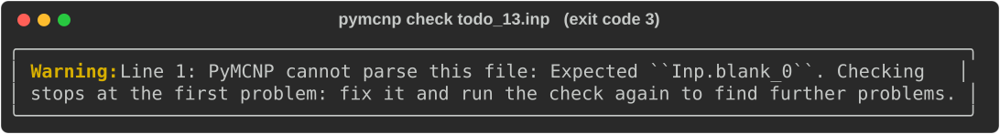
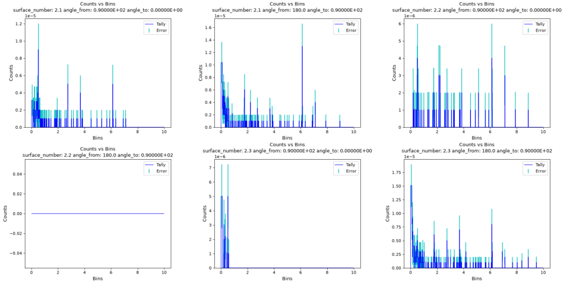

# PyMCNP CLI

The `pymcnp` command checks and formats MCNP input files, visualizes their geometry, runs MCNP, and converts and plots
the results. Only `pymcnp run` needs MCNP. The examples use the files in the
[examples directory](https://github.com/FSIBT/PyMCNP/tree/main/examples) of the repository.

Output files are written next to the input file. PDFs replace the extension, e.g., `example_00.pdf` for
`example_00.outp`; a file name without an extension, e.g., MCNP's default `outp`, gets one added: `outp.pdf`.
`pymcnp convert` appends its extension to the whole file name, e.g., `example_00.outp.csv`, so that the OUTP and PTRAC
files of one run do not write the same file.

## Exit codes

Every command exits with one of these codes:

| Exit code | Meaning |
|---|---|
| 0 | Success. |
| 1 | The input or output has problems, or the command failed, e.g., a run of MCNP failed or there is nothing to convert. |
| 2 | Usage error, e.g., an unknown option or command, or a cell, surface or tally that is not in the file; or a file that does not exist or cannot be read as text, e.g., a binary PTRAC file. |
| 3 | PyMCNP cannot parse all of a file. The command warns with the line where parsing stopped and works with the part before it, if it can. |

A card of an input file that PyMCNP cannot parse is named with its line number, as `pymcnp check` does. A data card
leaves the cards before it; a cell or surface card leaves nothing to work with.

## Commands

### Check

    pymcnp check example_00.inp
    pymcnp check --diff model.inp
    pymcnp check --fix model.inp

`pymcnp check` parses an input file and looks for lines wider than MCNP's 80 columns. `--diff` shows how PyMCNP would
rewrap them and `--fix` rewrites the file in place. The exit code says what it found:

| Exit code | Meaning |
|---|---|
| 0 | No problems (or `--fix` reformatted the file and no line is wider than 80 columns). |
| 1 | Lines wider than 80 columns; with `--fix`, lines it cannot shorten, e.g., long comments. |
| 2 | Usage error, or the file does not exist or cannot be read as text. |
| 3 | PyMCNP cannot parse a card; checking stops there. `--fix` refuses to rewrite such a file. |




`--fix` writes the file as PyMCNP prints it, which is equivalent but not identical: shorthands such as `511i` become
explicit values. Commit or copy the file first.

### Visualize

    pymcnp visualize example_00.inp
    pymcnp visualize -s 2,3 example_00.inp
    pymcnp visualize --cells-skip=777,999 --pdf example_00.inp

Without options, `pymcnp visualize` shows all cells and then all surfaces in a [PyVista](https://pyvista.org) window.
The options take comma-separated numbers. With `--pdf`, it writes a PDF next to the input instead of opening a window,
named after the option: `example_00-surface_2_3.pdf`, `example_00-cells-skip.pdf`, `example_00-cells.pdf`, and so on.
It exits with 2 if a listed cell or surface does not exist or an option is not a list of numbers, and with 1 if PyMCNP
cannot visualize the geometry. If PyMCNP cannot parse a card, it warns with the card's line number, draws the cards
before it, and exits with 3, as `pymcnp check` does.

### Run

    pymcnp run example_00.inp
    pymcnp run -c mcnp6.3 -p runs sphere-*.inp

`pymcnp run` needs MCNP. It runs the given inputs in parallel, at most one per CPU, with the command given by `-c` (default
`mcnp6`, found on `PATH`; MCNP finds its data through `DATAPATH`). `-p` names the directory for the runs (default: the
current directory). It creates `<path>/pymcnp-<timestamp>/` with one directory per input, `run-00000`, `run-00001`, ...,
each holding `run-0000N.inp`, `.outp`, `.ptrac`, `.runtpe`, and `.log` (the standard output of MCNP); files such as
`meshtal` keep MCNP's default names. It exits with 1 if a run failed or the MCNP command is not found, and with 2 if an
input does not exist or cannot be read. If PyMCNP cannot parse a card of an input, the cards from there on would be
missing from the run, so it warns with the card's line number, runs nothing, and exits with 3. For more control, e.g., run names or hooks, use [`pymcnp.Run`](pymcnp.md) in Python.

### Convert

    pymcnp convert outp --csv example_00.outp
    pymcnp convert ptrac --parquet example_02.ptrac
    pymcnp convert meshtal --csv meshtal.msht

`pymcnp convert` writes a CSV or parquet file next to the input, e.g., `example_00.outp.csv`. For OUTP files, it writes all
parsed tallies; for PTRAC files, one row per event; for MESHTAL files, the rows of all mesh tallies, with a `number`
column for the tally number. A tally in an OUTP layout PyMCNP cannot parse yet is left out, and PyMCNP issues a warning
naming it. If PyMCNP cannot parse part of an OUTP or PTRAC file, it writes what it parsed before that part, warns
with the line where parsing stopped (for PTRAC, the start of the history that holds the bad line), and exits with 3,
as `pymcnp visualize` does. If there is nothing to convert, e.g., no tally PyMCNP can parse, it writes no file and exits
with 1. Large PTRAC files are better streamed in Python with `Ptrac.to_parquet`.

### Plot

    pymcnp plot example_00.outp 1
    pymcnp plot --pdf example_00.outp 1

`pymcnp plot` plots one tally of an OUTP file, given by its number, with one figure per combination of the other bins
(e.g., surface facet and angle bin). With `--pdf`, it writes all figures to `example_00.pdf` instead of showing them.
It exits with 2 if the tally is not in the file, or is in a layout PyMCNP cannot parse yet. If PyMCNP cannot parse
part of the file, it plots the tally if it was parsed, warns, and exits with 3.

For tally 1 of `example_00.outp`, these are six figures, the three facets of surface 2 times the two angle bins (shown
here side by side):



## Manual Pages

The manual page for `pymcnp`:

```{eval-rst}
.. literalinclude:: ../../src/pymcnp/_cli/main.py
   :language: text
   :start-after: """
   :end-before: """
```

### pymcnp check

The manual page for `pymcnp check`:

```{eval-rst}
.. literalinclude:: ../../src/pymcnp/_cli/check.py
   :language: text
   :start-after: """
   :end-before: """
```

### pymcnp convert

The manual page for `pymcnp convert`:

```{eval-rst}
.. literalinclude:: ../../src/pymcnp/_cli/convert.py
   :language: text
   :start-after: """
   :end-before: """
```

### pymcnp plot

The manual page for `pymcnp plot`:

```{eval-rst}
.. literalinclude:: ../../src/pymcnp/_cli/plot.py
   :language: text
   :start-after: """
   :end-before: """
```

### pymcnp run

The manual page for `pymcnp run`:

```{eval-rst}
.. literalinclude:: ../../src/pymcnp/_cli/run.py
   :language: text
   :start-after: """
   :end-before: """
```

### pymcnp visualize

The manual page for `pymcnp visualize`:

```{eval-rst}
.. literalinclude:: ../../src/pymcnp/_cli/visualize.py
   :language: text
   :start-after: """
   :end-before: """
```
