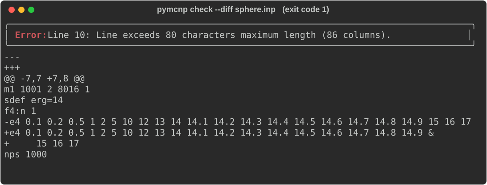

# PyMCNP CLI

The `pymcnp` command checks and formats MCNP input files, visualizes their geometry, runs MCNP, and converts and plots
the results. Only `pymcnp run` needs MCNP. The examples use the files in the
[examples directory](https://github.com/FSIBT/PyMCNP/tree/main/examples) of the repository.

Output files are written next to the input file, with the extension replaced, so the input file name needs an extension,
e.g., `example_00.outp` rather than `outp`.

## Commands

### Check

    pymcnp check example_00.inp
    pymcnp check --diff model.inp
    pymcnp check --fix model.inp

`pymcnp check` parses an input file and looks for lines wider than MCNP's 80 columns. `--diff` shows how PyMCNP would
rewrap them and `--fix` rewrites the file in place. The exit code says what it found:

| Exit code | Meaning |
|---|---|
| 0 | No problems (or `--fix` reformatted the file). |
| 1 | Lines wider than 80 columns. |
| 2 | The file does not exist. |
| 3 | PyMCNP cannot parse a card; checking stops there. `--fix` refuses to rewrite such a file. |





`--fix` writes the file as PyMCNP prints it, which is equivalent but not identical: shorthands such as `511i` become
explicit values. Commit or copy the file first.

### Visualize

    pymcnp visualize example_00.inp
    pymcnp visualize -s 2,3 example_00.inp
    pymcnp visualize --cells-skip=777,999 --pdf example_00.inp

Without options, `pymcnp visualize` shows all cells and then all surfaces in a [PyVista](https://pyvista.org) window.
The options take comma-separated numbers. With `--pdf`, it writes a PDF next to the input instead of opening a window,
named after the option: `example_00-surface_2_3.pdf`, `example_00-cells-skip.pdf`, `example_00-cells.pdf`, and so on.
It exits with 2 if a listed cell or surface does not exist.

### Run

    pymcnp run example_00.inp
    pymcnp run -c mcnp6.3 -p runs sphere-*.inp

`pymcnp run` needs MCNP. It runs the given inputs in parallel, at most one per CPU, with the command given by `-c` (default
`mcnp6`, found on `PATH`; MCNP finds its data through `DATAPATH`). `-p` names the directory for the runs (default: the
current directory). It creates `<path>/pymcnp-<timestamp>/` with one directory per input, `run-00000`, `run-00001`, ...,
each holding `run-0000N.inp`, `.outp`, `.ptrac`, `.runtpe`, and `.log` (the standard output of MCNP); files such as
`meshtal` keep MCNP's default names. It exits with 1 if an input cannot be read and with 2 if a run failed. For more
control, e.g., run names or hooks, use [`pymcnp.Run`](pymcnp.md) in Python.

### Convert

    pymcnp convert outp --csv example_00.outp
    pymcnp convert ptrac --parquet example_02.ptrac
    pymcnp convert meshtal --csv meshtal.msht

`pymcnp convert` writes a CSV or parquet file next to the input, e.g., `example_00.csv`. For OUTP files, it writes all
parsed tallies; for PTRAC files, one row per event; for MESHTAL files, the rows of all mesh tallies, with a `tally`
column for the tally number. A tally in an OUTP layout PyMCNP cannot parse yet is left out, and PyMCNP issues a warning
naming it. Large PTRAC files are better streamed in Python with `Ptrac.to_parquet`.

### Plot

    pymcnp plot example_00.outp 1
    pymcnp plot --pdf example_00.outp 1

`pymcnp plot` plots one tally of an OUTP file, given by its number, with one figure per combination of the other bins
(e.g., surface facet and angle bin). With `--pdf`, it writes all figures to `example_00.pdf` instead of showing them.

## Manual Pages

The manual page for `pymcnp`:

```{eval-rst}
.. literalinclude:: ../../src/pymcnp/_cli/main.py
   :language: text
   :start-after: """
   :end-before: """
```

### pymcnp check

The manual page for `pymcnp check`:

```{eval-rst}
.. literalinclude:: ../../src/pymcnp/_cli/check.py
   :language: text
   :start-after: """
   :end-before: """
```

### pymcnp convert

The manual page for `pymcnp convert`:

```{eval-rst}
.. literalinclude:: ../../src/pymcnp/_cli/convert.py
   :language: text
   :start-after: """
   :end-before: """
```

### pymcnp plot

The manual page for `pymcnp plot`:

```{eval-rst}
.. literalinclude:: ../../src/pymcnp/_cli/plot.py
   :language: text
   :start-after: """
   :end-before: """
```

### pymcnp run

The manual page for `pymcnp run`:

```{eval-rst}
.. literalinclude:: ../../src/pymcnp/_cli/run.py
   :language: text
   :start-after: """
   :end-before: """
```

### pymcnp visualize

The manual page for `pymcnp visualize`:

```{eval-rst}
.. literalinclude:: ../../src/pymcnp/_cli/visualize.py
   :language: text
   :start-after: """
   :end-before: """
```
