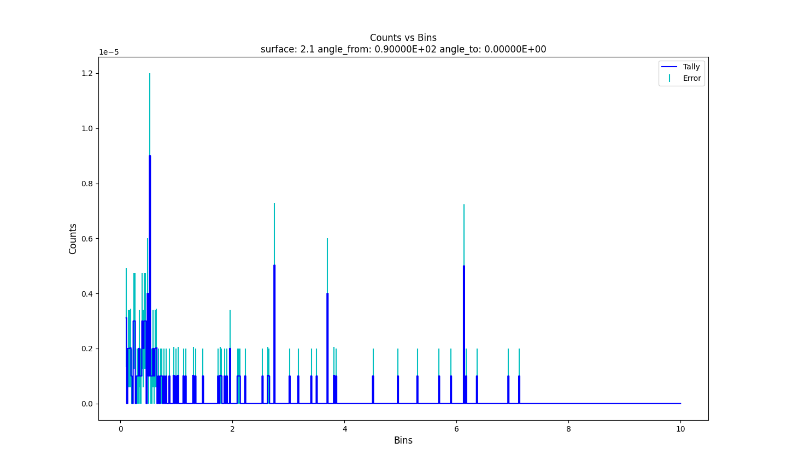
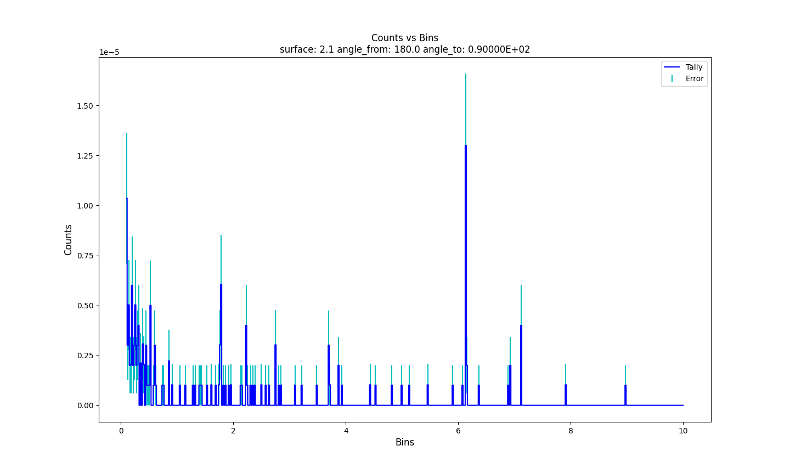
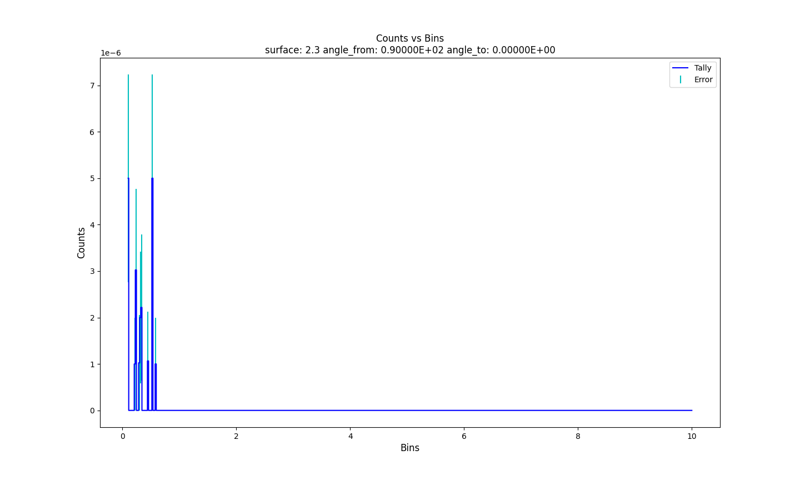
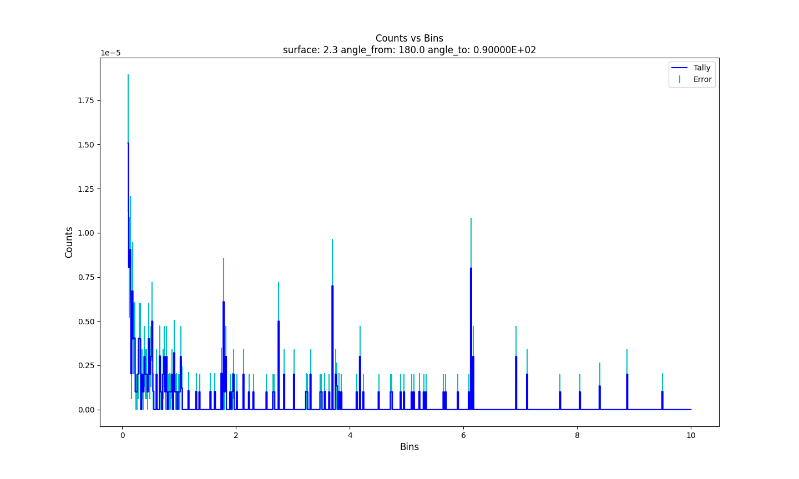
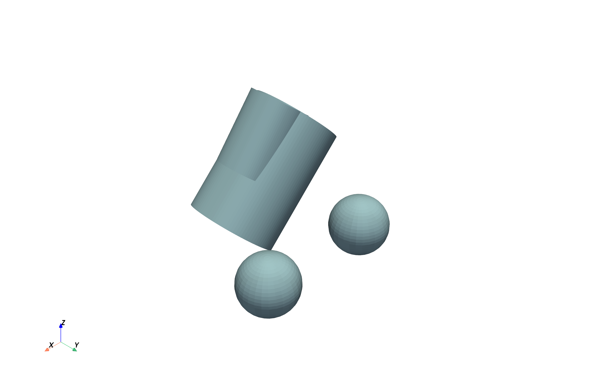
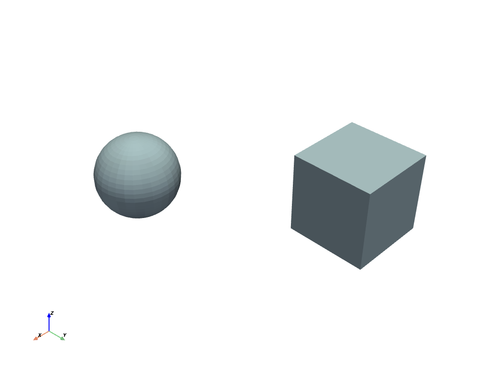
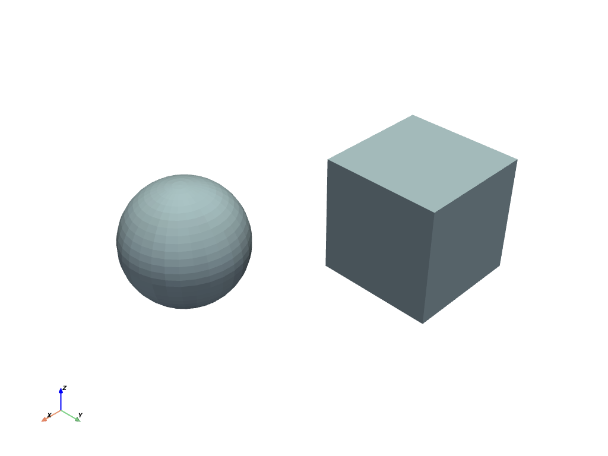
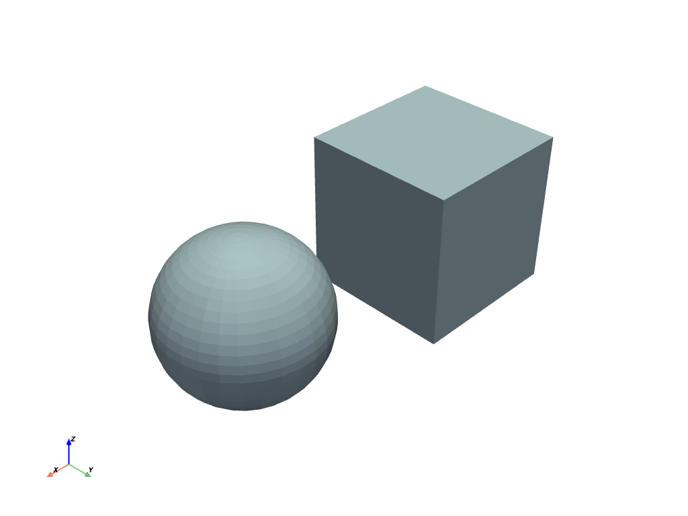
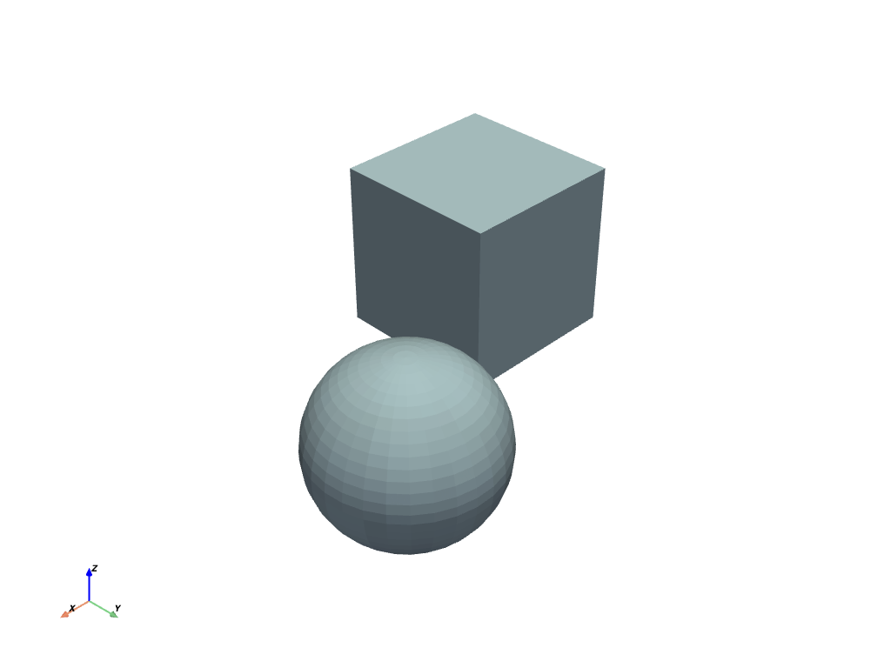
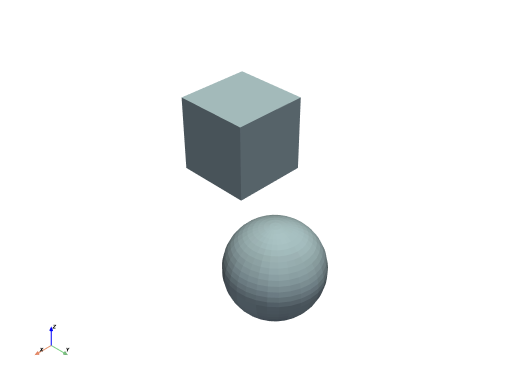

# "Do" Examples

PyMCNP enables common workflows using `pyvista`, `pandas`, `subprocesss`, `matplotlib`, and `difflib`.

## Checking INP Files

```{eval-rst}
.. note:: 
   This example requires `example_00.inp <https://github.com/FSIBT/PyMCNP/blob/main/examples/example_00.inp>`_.
```

Code:

```{eval-rst}
.. literalinclude:: ../../../examples/do_check.py
   :language: python
```

Output:

    Checking INP file: `examples/output/example_00.inp`
    Fixing and writing to INP file: `examples/output/example_00.inp`

## Converting OUTP Files

```{eval-rst}
.. note:: 
   This example requires `example_00.outp <https://github.com/FSIBT/PyMCNP/blob/main/examples/example_00.outp>`_.
```

Code:

```{eval-rst}
.. literalinclude:: ../../../examples/do_convert.py
   :language: python
```

Output:

    Converting tally #1 from `PyMCNP/files/outp/example_00.outp` to `examples/output/example_00-1.csv`
    Converting tally #1 from `PyMCNP/files/outp/example_00.outp` to `examples/output/example_00-1.parquet`

## Plotting OUTP Files

```{eval-rst}
.. note:: 
   This example requires `example_00.outp <https://github.com/FSIBT/PyMCNP/blob/main/examples/example_00.outp>`_.
```

Code:

```{eval-rst}
.. literalinclude:: ../../../examples/do_plot.py
   :language: python
```

Output:

    Plotting tally #1 from files/outp/example_00.outp.
    Writing plots tally #1 from files/outp/example_00.outp to `examples/output/example_00-1.pdf`.






## Running INP Files

```{eval-rst}
.. note:: 
   This example requires `example_00.inp <https://github.com/FSIBT/PyMCNP/blob/main/examples/example_00.inp>`_, `example_01.inp <https://github.com/FSIBT/PyMCNP/blob/main/examples/example_01.inp>`_, and `example_02.inp <https://github.com/FSIBT/PyMCNP/blob/main/examples/example_02.inp>`_.
```

Code:

```{eval-rst}
.. literalinclude:: ../../../examples/do_run.py
   :language: python
```

Output:

    Running `echo` in `examples/output`:
    Calling `prehook_batch` examples/output/pymcnp-2025-08-22--01-12-44
    Calling `prehook_file` examples/output/pymcnp-2025-08-22--01-12-44/run-00000 0
    inp=examples/output/pymcnp-2025-08-22--01-12-44/run-00000/run-00000.inp outp=examples/output/pymcnp-2025-08-22--01-12-44/run-00000/run-00000.outp ptrac=examples/output/pymcnp-2025-08-22--01-12-44/run-00000/run-00000.ptrac
    Calling `prehook_file` examples/output/pymcnp-2025-08-22--01-12-44/run-00001 1
    inp=examples/output/pymcnp-2025-08-22--01-12-44/run-00001/run-00001.inp outp=examples/output/pymcnp-2025-08-22--01-12-44/run-00001/run-00001.outp ptrac=examples/output/pymcnp-2025-08-22--01-12-44/run-00001/run-00001.ptrac
    Calling `prehook_file` examples/output/pymcnp-2025-08-22--01-12-44/run-00002 2
    Calling `posthook_file` examples/output/pymcnp-2025-08-22--01-12-44/run-00000 0
    Calling `posthook_file` examples/output/pymcnp-2025-08-22--01-12-44/run-00001 1
    inp=examples/output/pymcnp-2025-08-22--01-12-44/run-00002/run-00002.inp outp=examples/output/pymcnp-2025-08-22--01-12-44/run-00002/run-00002.outp ptrac=examples/output/pymcnp-2025-08-22--01-12-44/run-00002/run-00002.ptrac
    Calling `posthook_file` examples/output/pymcnp-2025-08-22--01-12-44/run-00002 2
    Calling `posthook_batch` examples/output/pymcnp-2025-08-22--01-12-44

## Visualizing INP Files

```{eval-rst}
.. note:: 
   This example requires `example_05.inp <https://github.com/FSIBT/PyMCNP/blob/main/examples/example_05.inp>`_.
```

Code:

```{eval-rst}
.. literalinclude:: ../../../examples/do_visualize.py
   :language: python
```

Output:

    Visualizing all surfaces from `example_05.inp`.
    Writing visualizations of all surfaces from `example_05.inp` to `examples/output/example_05-surfaces.pdf`



## Parameter Scan

```{eval-rst}
.. note:: 
   This example requires `example_01.outp <https://github.com/FSIBT/PyMCNP/blob/main/examples/example_01.outp>`_ and `example_04.inp <https://github.com/FSIBT/PyMCNP/blob/main/examples/example_04.inp>`_.
```

Code:

```{eval-rst}
.. literalinclude:: ../../../examples/do_parameter_scan.py
   :language: python
```

Output:

    Running parameter scan `echo` in `examples/output`:
    inp=examples/output/pymcnp-2025-08-22--01-52-15/run-00000/run-00000.inp outp=examples/output/pymcnp-2025-08-22--01-52-15/run-00000/run-00000.outp ptrac=examples/output/pymcnp-2025-08-22--01-52-15/run-00000/run-00000.ptrac
    inp=examples/output/pymcnp-2025-08-22--01-52-15/run-00001/run-00001.inp outp=examples/output/pymcnp-2025-08-22--01-52-15/run-00001/run-00001.outp ptrac=examples/output/pymcnp-2025-08-22--01-52-15/run-00001/run-00001.ptrac
    inp=examples/output/pymcnp-2025-08-22--01-52-15/run-00002/run-00002.inp outp=examples/output/pymcnp-2025-08-22--01-52-15/run-00002/run-00002.outp ptrac=examples/output/pymcnp-2025-08-22--01-52-15/run-00002/run-00002.ptrac
    inp=examples/output/pymcnp-2025-08-22--01-52-15/run-00003/run-00003.inp outp=examples/output/pymcnp-2025-08-22--01-52-15/run-00003/run-00003.outp ptrac=examples/output/pymcnp-2025-08-22--01-52-15/run-00003/run-00003.ptrac
    inp=examples/output/pymcnp-2025-08-22--01-52-15/run-00004/run-00004.inp outp=examples/output/pymcnp-2025-08-22--01-52-15/run-00004/run-00004.outp ptrac=examples/output/pymcnp-2025-08-22--01-52-15/run-00004/run-00004.ptrac
    DONE! :)






