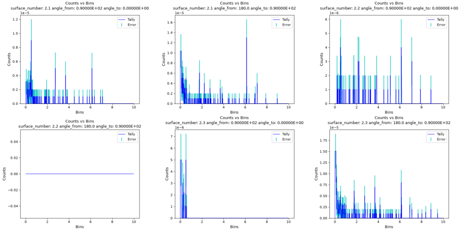
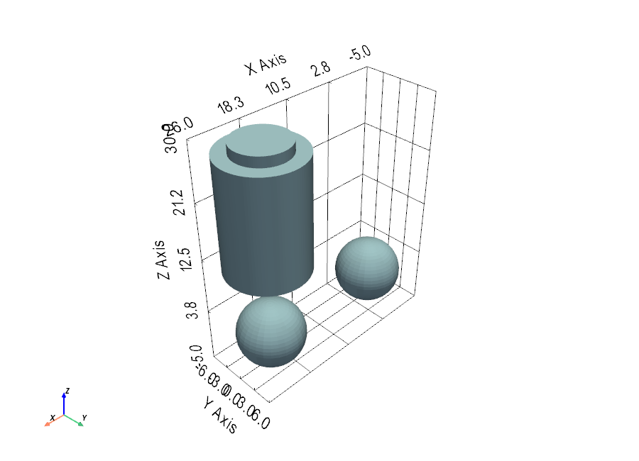
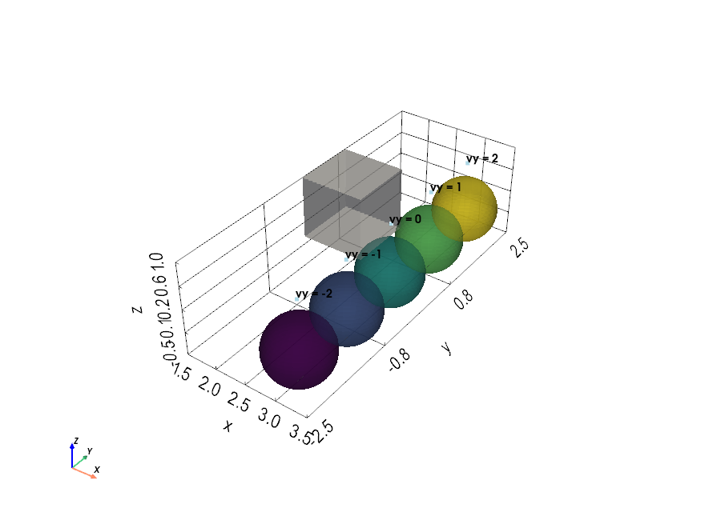

# "Do" Examples

PyMCNP enables common workflows using `pyvista`, `pandas`, `subprocess`, `matplotlib`, and `difflib`. The images on this
page are made by `docs/make_images.py` from the same example files, without MCNP.

## Checking INP Files

```{eval-rst}
.. note:: 
   This example requires `example_00.inp <https://github.com/FSIBT/PyMCNP/blob/main/examples/example_00.inp>`_.
```

Code:

```{eval-rst}
.. literalinclude:: ../../../examples/do_check.py
   :language: python
```

Output:

    Checking INP file: `examples/output/example_00.inp`
    219 lines differ from the reformatted file.
    Fixing and writing to INP file: `examples/output/example_00.inp`

## Converting OUTP Files

```{eval-rst}
.. note:: 
   This example requires `example_00.outp <https://github.com/FSIBT/PyMCNP/blob/main/examples/example_00.outp>`_.
```

Code:

```{eval-rst}
.. literalinclude:: ../../../examples/do_convert.py
   :language: python
```

Output:

    Converting the tallies from `examples/example_00.outp` to `examples/output/example_00.csv` and `examples/output/example_00.parquet`
    Converting tally #1 from `examples/example_00.outp` to `examples/output/example_00-1.csv`

## Plotting OUTP Files

```{eval-rst}
.. note:: 
   This example requires `example_00.outp <https://github.com/FSIBT/PyMCNP/blob/main/examples/example_00.outp>`_.
```

Code:

```{eval-rst}
.. literalinclude:: ../../../examples/do_plot.py
   :language: python
```

Output:

    Plotting tally #1 from examples/example_00.outp.
    Writing plots tally #1 from examples/example_00.outp to `examples/output/example_00-1.pdf`.

`Plot` makes one figure per combination of the other columns of the tally, here the three facets of surface 2 times the two
angle bins of the `*c1 90 0` card, so `to_show` returns six figures and `to_pdf` writes six pages:



## Running INP Files

```{eval-rst}
.. note:: 
   This example requires `example_00.inp <https://github.com/FSIBT/PyMCNP/blob/main/examples/example_00.inp>`_, `example_01.inp <https://github.com/FSIBT/PyMCNP/blob/main/examples/example_01.inp>`_, and `example_02.inp <https://github.com/FSIBT/PyMCNP/blob/main/examples/example_02.inp>`_.
```

Code:

```{eval-rst}
.. literalinclude:: ../../../examples/do_run.py
   :language: python
```

Output:

    Running `echo` in `examples/output`:
    Calling `prehook_batch` pymcnp-2026-11-26--06-49-02
    Calling `prehook_file` 0 in run-00000
    Calling `prehook_file` 1 in run-00001
    Calling `posthook_file` run-00000 0 (ok=False)
    Calling `posthook_file` run-00001 1 (ok=False)
    Calling `prehook_file` 2 in run-00002
    Calling `posthook_file` run-00002 2 (ok=False)
    Calling `posthook_batch` pymcnp-2026-11-26--06-49-02
    Run 0: exit code 0, input `run-00000.inp`, output `None`
    Run 1: exit code 0, input `run-00001.inp`, output `None`
    Run 2: exit code 0, input `run-00002.inp`, output `None`

On Windows the stand-in is `where`, which prints that it found no file and exits with 1, so each run reads `exit code 1`.

With a real MCNP (`command='mcnp6'`) every run writes its output files into its own directory `examples/output/pymcnp-<timestamp>/run-0000N/`, `ok` is true for runs that finished without fatal errors, and `Run.run` raises if one failed (the default `check=True`).

## Visualizing INP Files

```{eval-rst}
.. note:: 
   This example requires `example_05.inp <https://github.com/FSIBT/PyMCNP/blob/main/examples/example_05.inp>`_.
```

Code:

```{eval-rst}
.. literalinclude:: ../../../examples/do_visualize.py
   :language: python
```

Output:

    Visualizing all surfaces from `examples/example_05.inp`.
    Writing visualizations of all surfaces from `examples/example_05.inp` to `examples/output/example_05-surfaces.pdf`



## Parameter Scan

```{eval-rst}
.. note:: 
   This example requires `example_01.outp <https://github.com/FSIBT/PyMCNP/blob/main/examples/example_01.outp>`_ and `example_04.inp <https://github.com/FSIBT/PyMCNP/blob/main/examples/example_04.inp>`_.
```

Code:

```{eval-rst}
.. literalinclude:: ../../../examples/do_parameter_scan.py
   :language: python
```

Output:

    Running parameter scan `echo` in `examples/output`:
    DONE! :)

The script shows the surfaces of each input in its own window. Drawn together, the five inputs differ only in the
position of the sphere, which `scan` moves along y; the box stays in place:



`inp.scan(**{'surfaces[11].vy': [...]})` sets a nested field by its path: attributes with `.name` and list items with
`[i]`, where the index into `cells` and `surfaces` is the card number, here surface 11. Settable properties such as `nps` and `seed` take plain keywords, `inp.scan(nps=[10**4, 10**5])`, and
`inp.scan_with(values, apply)` calls a function on each copy for changes that need code.
