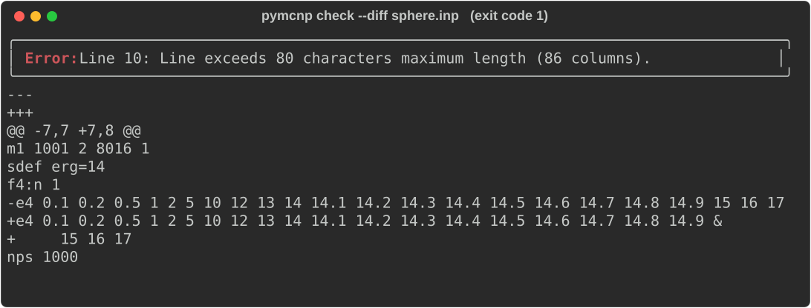
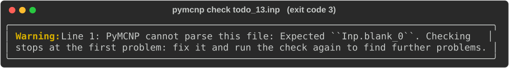
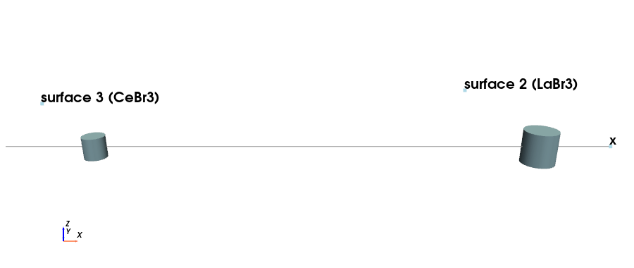
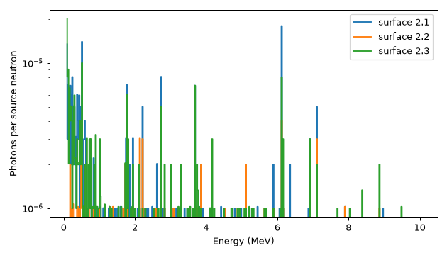

# Getting Started

This page takes you from installing PyMCNP to reading the results of a run, using the example files of the repository.
Everything except running MCNP itself works without MCNP.

## What PyMCNP Does

PyMCNP reads and writes the input file of [MCNP](https://mcnp.lanl.gov) and reads its output files, as Python objects
and `pandas` dataframes. It checks, edits and visualizes inputs, builds parameter scans, runs MCNP in parallel, and
converts and plots the results. Its command line tool, `pymcnp`, does the common tasks without writing Python.

PyMCNP does not include MCNP or its nuclear data. MCNP is export controlled and distributed by
[RSICC](https://rsicc.ornl.gov) under a licence from Los Alamos National Laboratory; get it there, then tell PyMCNP how
to start it (see [Running MCNP](#running-mcnp)).

### Files and Terms

MCNP calls its files by the names below, and so does PyMCNP:

| Name | File | PyMCNP | Supported |
|---|---|---|---|
| INP | input file (the deck), e.g., `model.inp` | `pymcnp.Inp` | MCNP 6.1 to 6.3 inputs; not every card and option yet |
| OUTP | the main output file (`outp`, `.o`) | `pymcnp.Outp` | summary, statistical checks, activity tables, and cell and surface tally tables (e.g., F1, F2, F4); other layouts, e.g., F8 pulse height tallies, are skipped with a warning |
| MESHTAL | mesh tally output (`meshtal`) of `FMESH` tallies | `pymcnp.Meshtal` | all mesh tallies of a file |
| PTRAC | particle track output (`ptrac`) | `pymcnp.Ptrac` | ASCII files only (`PTRAC FILE=ASC`) |

PyMCNP does not read MCTAL files, binary PTRAC files or RUNTPE files.

An input is made of *cards*, one per cell, surface or data entry, e.g., `1 so 600` or `nps 1000000`. PyMCNP turns every
card into an object of a class named after the card: `pymcnp.inp.card.surface.So`, `pymcnp.inp.card.data.Nps`, and so
on, with fields named as in the MCNP manual (`j` for the number, `r` for the radius, ...). Printing an object, or calling
`to_mcnp()`, writes it as MCNP text again.

Every parser returns a pair `(object, remainder)`. The remainder is the text PyMCNP could not parse: it stops at the first
card it does not understand. An empty remainder means the whole file was read, so check it every time. MCNP has many
options and PyMCNP does not cover all of them yet; when it stops on a valid file, please
[report it](https://github.com/FSIBT/PyMCNP/issues). For OUTP files, a tally in a layout PyMCNP cannot parse yet leaves
no remainder; instead PyMCNP issues a warning (`pymcnp.abc.Warning`, "Tally not parsed.") that names the tally.

## 1. Install PyMCNP

PyMCNP needs Python 3.11 or newer. Install it from PyPI (see [Installation](installation.md) for other ways):

    pip install pymcnp

Check that the command line tool works:

    pymcnp --version

## 2. Get the Example Files

The example files are in the [examples directory](https://github.com/FSIBT/PyMCNP/tree/main/examples) of the
repository; they are not installed with the package. Clone the repository,

    git clone https://github.com/FSIBT/PyMCNP
    cd PyMCNP/examples

or download [example_00.inp](https://github.com/FSIBT/PyMCNP/blob/main/examples/example_00.inp) and
[example_00.outp](https://github.com/FSIBT/PyMCNP/blob/main/examples/example_00.outp) into one directory. `example_00.inp`
is an isotropic neutron source over a slab of lunar regolith, with two gamma detectors; `example_00.outp` is the output
of an MCNP run of it.

## 3. Check an Input

`pymcnp check` tells you whether PyMCNP can read an input and whether its lines fit MCNP's 80 columns:

    pymcnp check example_00.inp


Its exit code says what it found:

| Exit code | Meaning |
|---|---|
| 0 | No problems (or `--fix` reformatted the file). |
| 1 | Lines wider than 80 columns, which MCNP rejects. `--diff` shows how `--fix` would rewrap them; `--fix` rewrites the file in place. |
| 2 | The file does not exist. |
| 3 | PyMCNP cannot parse a card. MCNP may still accept it. Checking stops at that card, so check again after fixing it. `--fix` refuses to rewrite such a file. |





## 4. Read and Edit an Input in Python

```python
import pymcnp

inp, rest = pymcnp.Inp.from_file('example_00.inp')
assert rest == '', 'PyMCNP could not read the whole file'

print(inp.title)
print(inp.surface_cards(99)[0])  # the outer sphere
print(inp.nps)

inp.surface_cards(99)[0].r = 700  # a larger world sphere
inp.nps = 10**5
inp.to_file('example_00_big.inp')
```

Output:

    Isotropic neutron source over lunar regolith with two gamma detectors

    99  so 600
    1000000

`inp.cell_cards(...)`, `inp.surface_cards(...)` and `inp.data_cards(...)` find cards and return the cards themselves, so
changing a field changes the input. `inp.scan(...)` and `inp.scan_with(...)` make one copy of the input per parameter
value for a parameter scan ([example](examples/do.md)). The written file is equivalent to the original, not identical:
PyMCNP writes shorthands such as `511i` as explicit values and wraps long lines.

## 5. Look at the Geometry

`pymcnp visualize` draws cells and surfaces with [PyVista](https://pyvista.org) in a window; with `--pdf` it writes a
PDF next to the input instead (here `example_00-surface_2_3.pdf`). The two detectors of `example_00.inp` are surfaces 2
and 3:

    pymcnp visualize -s 2,3 example_00.inp



Without options, it shows all cells and then all surfaces. Look at the geometry of every new or generated model before
running it.

## 6. Read Results Without MCNP

`example_00.outp` is the output of a run of `example_00.inp`, so you can read results without running MCNP:

```python
import pymcnp

outp, rest = pymcnp.Outp.from_file('example_00.outp')
summary = outp.summary
print(summary.version, summary.nps, summary.terminated, summary.ok)
print(summary.checks_passed)
for number, check in summary.checks.items():
    print(number, check.passed, check.failed, check.message)

tally = outp.tally(1)
print(tally[['bins', 'counts', 'errors', 'angle_from', 'surface', 'facet']].head())
```

Output:

    MCNP_6.20, 6.2.0 1000000 histories True
    False
    1 False 1 there is insufficient tfc bin tally information to estimate the large tally slope reliably
    21 False 2 the relative error exceeds the recommended value of 0.1 for nonpoint detector tallies
          bins    counts  errors  angle_from  surface  facet
    0  0.10000  0.000010  0.3177       180.0        2      1
    1  0.11934  0.000003  0.5773       180.0        2      1
    2  0.13867  0.000005  0.4472       180.0        2      1
    3  0.15801  0.000002  0.7071       180.0        2      1
    4  0.17734  0.000002  0.7072       180.0        2      1

`summary.ok` says the run finished without fatal errors; `summary.checks_passed` is `False` because both tallies fail
some of MCNP's ten statistical checks, so this short run needs more histories before its tallies can be trusted. Check
both before you use a result. `outp.tally(n)` returns one tally as a dataframe with typed columns: `bins` (here the upper
energy bin edges in MeV), `counts`, the relative `errors`, and one column per other bin dimension, here the surface facet
and the cosine bin.

The dataframe goes straight into `matplotlib`:

```python
import matplotlib.pyplot
import pymcnp

outp, _ = pymcnp.Outp.from_file('example_00.outp')
tally = outp.tally(1)
spectra = tally.groupby(['surface', 'facet', 'bins'], as_index=False)['counts'].sum()  # add up the two angle bins

figure, axis = matplotlib.pyplot.subplots(figsize=(7, 4))
for (surface, facet), rows in spectra.groupby(['surface', 'facet']):
    axis.step(rows['bins'], rows['counts'], where='pre', label=f'surface {surface}.{facet}')
axis.set_yscale('log')
axis.set_xlabel('Energy (MeV)')
axis.set_ylabel('Photons per source neutron')
axis.legend()
matplotlib.pyplot.show()
```



For a quick look, `pymcnp plot example_00.outp 1` plots every bin combination of tally 1, and with `--pdf` writes them
to `example_00.pdf`. `pymcnp convert outp --csv example_00.outp` writes all parsed tallies to `example_00.csv`.

(running-mcnp)=
## 7. Run MCNP

This step needs MCNP. PyMCNP starts MCNP as a program on your `PATH`, by default `mcnp6`, and MCNP finds its nuclear
data through the `DATAPATH` environment variable (the directory with the `xsdir` file). Set both as the MCNP
installation instructions say, then check that MCNP starts on its own, e.g., with `mcnp6 i=example_00.inp`.

Run one or more inputs with the command line tool:

    pymcnp run -p runs example_00_big.inp

`-c` (`--command`) names a different program, e.g., `pymcnp run -c mcnp6.3 ...`, and `-p` (`--path`) the directory
for the runs (default: the current directory). PyMCNP creates a directory `runs/pymcnp-<timestamp>/` for the batch and
one directory per input in it, `run-00000`, `run-00001`, ..., and runs MCNP there as
`mcnp6 inp=run-00000.inp outp=run-00000.outp ptrac=run-00000.ptrac runtpe=run-00000.runtpe`. Other output files, such as
`meshtal` and `mctal`, get MCNP's default names in the same directory. The runs go in parallel, at most one per CPU.

In Python, `Run` does the same and returns one `Result` per input:

```python
import pymcnp

inp, rest = pymcnp.Inp.from_file('example_00.inp')
assert rest == ''
inps = list(inp.scan_with([500, 600, 700], lambda copy, r: setattr(copy.surface_cards(99)[0], 'r', r)))

results = pymcnp.Run(inps, command='mcnp6', max_workers=3).run('runs')
for result in results:
    print(result.directory, result.ok, result.outp)
```

`Run.run` waits for all runs and raises `pymcnp.abc.Error` if one failed (non-zero exit code, no output file, or a
fatal error in the output), unless you create it with `check=False`; then test `result.ok`. `Run(...)` raises if the
command is not on `PATH`.

## Next Steps

- [Examples](examples.md): creating cards and inputs, reading every file type, checking, converting, plotting, running
  and parameter scans; [Automating Models, Runs, and Plots](examples/automate.md) builds a large model with loops and plots
  a mesh tally.
- [PyMCNP CLI](cli.md): all commands and options.
- [PyMCNP Library](pymcnp.md): the API, including streaming large PTRAC files (`Ptrac.stream`, `Ptrac.tracks`,
  `Ptrac.to_parquet`) and mesh tallies (`Meshtal.iter_tallies`).
- [Using PyMCNP with AI Agents](skill.md): let a coding agent write and run models for you.
