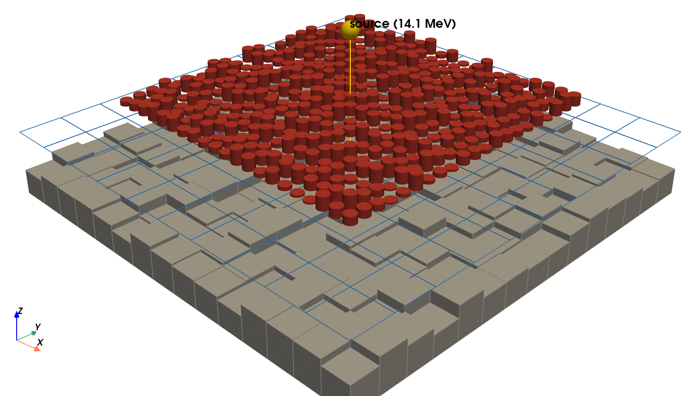
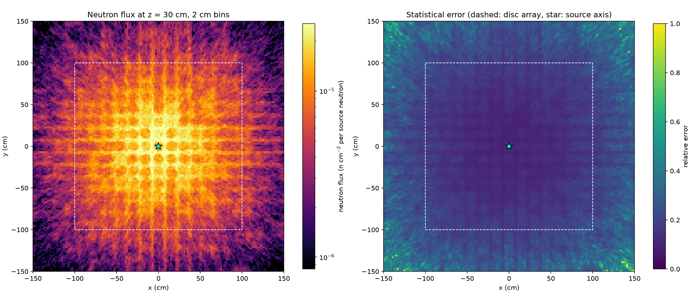

# PyMCNP Documentation

PyMCNP is a Python package and CLI for interfacing
with [MCNP](https://mcnp.lanl.gov). PyMCNP parsers MCNP files,
visualizes simulation geometries, and runs MCNP simulations in parallel.

## Example

Inputs are Python objects, so loops can build geometries that are impractical to write by hand, and the results go straight into `pandas` and `matplotlib`.
This builds 441 iron discs of random thickness over a rough concrete floor, tallies the neutron flux of a point source, and plots the result:

```python
import numpy as np
import pymcnp
from pymcnp.inp import card
from pymcnp.inp.card import surface

rng = np.random.default_rng(20260101)
surfaces, cells = [], []
for ix in range(-10, 11):
    for iy in range(-10, 11):
        x, y, thick = ix * 10.0, iy * 10.0, float(rng.uniform(1, 10))
        disc = surface.Rcc(j=len(surfaces) + 1, vx=x, vy=y, vz=50.0, h1=0.0, h2=0.0, h3=thick, r=4.0)
        surfaces.append(disc)
        cells.append(card.Cell_0(j=len(cells) + 1, m=1, d=-7.874, geom=-disc, options=['imp:n=1']))
# ... air, ground, source and FMESH tally, then inp.to_file('ground.inp')

# After `pymcnp run`: one row per mesh voxel.
(tally,) = pymcnp.Meshtal.iter_tallies('meshtal')
frame = tally.to_dataframe()
```




The [full example](examples/automate.md) includes the complete model, the geometry plot, and the flux plot.

## Automating with AI Coding Agents

PyMCNP ships a [skill file](https://github.com/FSIBT/PyMCNP/blob/main/SKILL.md) (`SKILL.md`) that describes the API, the parsing contract, and the common pitfalls to an AI coding agent such as [Claude Code](https://claude.com/claude-code).
With the skill installed (for Claude Code, copy it to `~/.claude/skills/pymcnp/SKILL.md`), an agent can write, scan, run, and plot MCNP models for you from a short description, so automating MCNP becomes easy even for complex geometries.
The example above was created this way from a short prompt.
Always review generated models and results before relying on them.

## Table of Contents

```{eval-rst}
.. toctree::
   :maxdepth: 1

   cli
   pymcnp

   installation
   examples
   contributing
```
