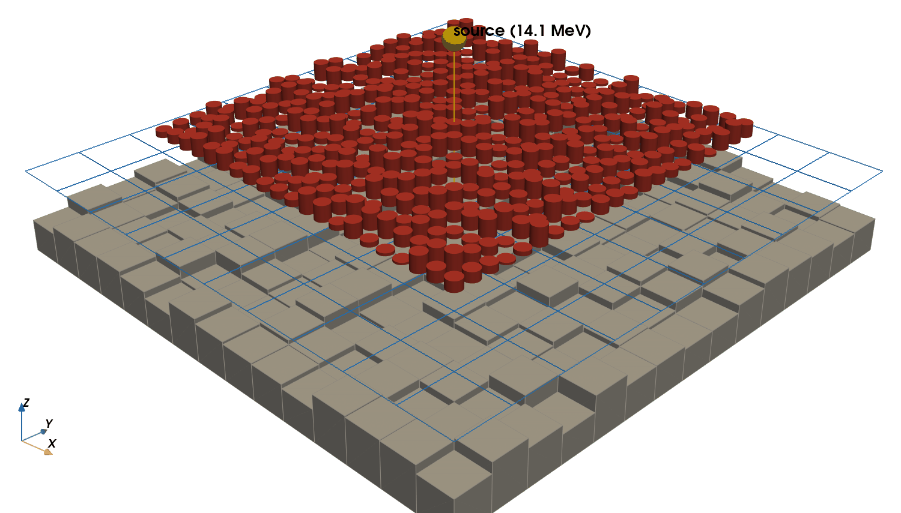
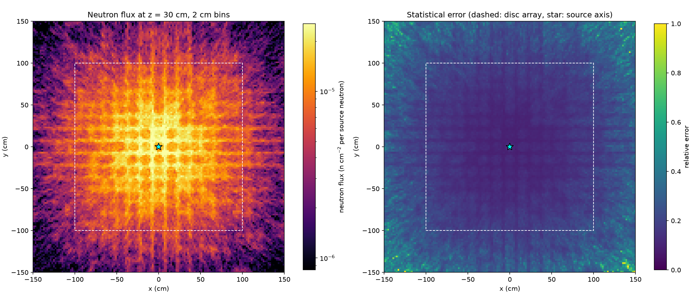

# PyMCNP Documentation

PyMCNP is a Python package and CLI for interfacing
with [MCNP](https://mcnp.lanl.gov). PyMCNP parsers MCNP files,
visualizes simulation geometries, and runs MCNP simulations in parallel.

## Example

Inputs are Python objects, so loops can build geometries that are impractical to write by hand, and the results go straight into `pandas` and `matplotlib`.
This builds 441 iron discs of random thickness over a rough concrete floor, tallies the neutron flux of a point source, and plots the result:

```{eval-rst}
.. literalinclude:: ../../examples/home.py
   :language: python
```




The [full example](examples/automate.md) includes the complete model, the geometry plot, and the flux plot.

## Table of Contents

```{eval-rst}
.. toctree::
   :maxdepth: 1

   cli
   pymcnp

   installation
   examples
   contributing
   skill
```
